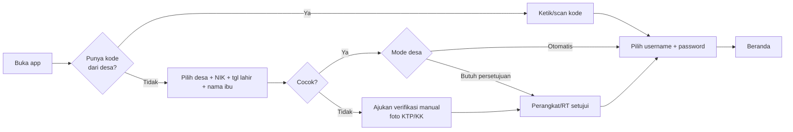
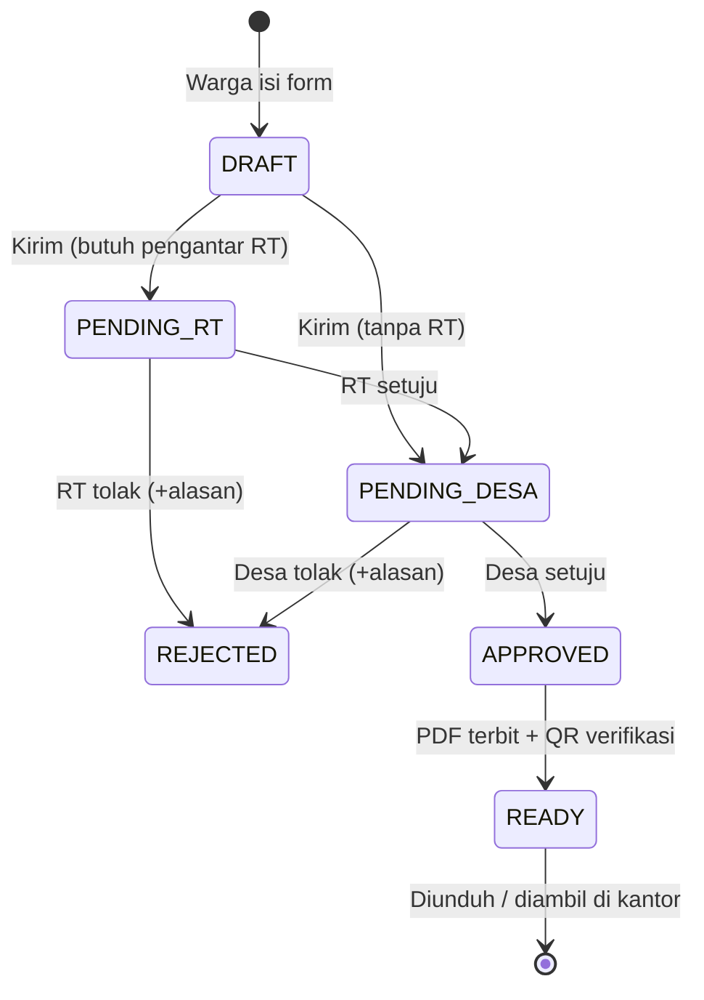

# Klandesa Mobile v2 — Riset, Analisis & Rencana

> Status: draf rencana (2026-10-22). Dasar analisis: kode `klandesa-webapp` (schema Prisma, ±88 route API, RBAC, modul), plan growth lama di `~/.cursor/plans/analisis_mobile_growth_klandesa_*`, dan pola proyek Expo `inti-english` / `anekaukm-mobile`.
> **Catatan kejujuran:** dokumen ini TIDAK memuat riset web/kompetitor langsung dan TIDAK melihat source app Play Store yang sekarang (tidak ada di mesin ini). Poin "kebutuhan fitur" berasal dari kapabilitas backend yang sudah ada + praktik umum aplikasi layanan desa di Indonesia. Validasi dengan 3–5 warga, 2 perangkat desa, 2 ketua RT dari client berbayar sebelum Phase 1 dikunci.

---

## 1. Temuan utama dari codebase

| # | Temuan | Dampak ke mobile |
|---|--------|------------------|
| 1 | Tabel `User` hanya untuk **staf desa** (`admin, staff, village_head, secretary`). **Warga (`Resident`) tidak punya akun/login.** | Blocker terbesar. Harus dibuat identitas warga (`CitizenAccount`) + alur aktivasi. |
| 2 | **Tidak ada role RT/RW** di `lib/permissions/roles.ts`. `RtRwActivity`, `CommunityProposal`, `Resident.rt/rw` ada, tapi belum ada "pemimpin RT" sebagai akun. | Perlu role + scope RT/RW (pembatasan data per RT). |
| 3 | Auth API = cookie NextAuth (`readAppSession`). `/api/auth/login` sudah mengembalikan `accessToken`/`refreshToken` (JWT), tapi route lain tidak membaca header `Authorization: Bearer`. | Perlu lapisan auth mobile (Bearer + refresh rotation). |
| 4 | Semua route desa lewat `requireVillageApiContext` + matriks RBAC admin; respons berbentuk data admin (mis. `citizen-reports` mengembalikan `reporter_nik` penuh). | Jangan pakai ulang endpoint admin untuk warga. Buat namespace baru `/api/mobile/v1/*` dengan DTO khusus. |
| 5 | Sudah ada: `MailRequest` + `MailTemplate`/`MailService` (layanan surat), `CitizenReport`+`CitizenReportResponse` (pengaduan), `Announcement`, `Attendance`+`WorkShift` + endpoint `attendance/check-in|scan|qr|history|today` (GPS+QR), `Kiosk`, `SocialBenefitProgram/Beneficiary` + `/api/public/social-benefits/check`, `Transaction/Budget` (APBDes), `ForumThread`, `Potential`/UKM, `Posyandu`, `NotificationRead`. | ±70% logika domain sudah ada. Pekerjaan mobile = **identitas, scoping, DTO, push, UI**, bukan domain baru. |
| 6 | **Tidak ada push notification** (tidak ada `expo`/`fcm`/`firebase` di `lib` & `app/api`). `AdminNotification` hanya untuk admin web, tanpa device token. | Perlu tabel `DeviceToken`, worker kirim, preferensi notifikasi. |
| 7 | Upload: presign S3 (`digital-archives/presign`). | Bisa dipakai ulang untuk foto pengaduan & lampiran surat (buat presign khusus mobile). |
| 8 | Gating langganan: `isVillageSubscriptionActive` + tier/modul (`lib/modules/entitlements.ts`). | Fitur mobile mengikuti modul yang dibeli desa; warga gratis, **desa yang membayar**. Perlu state "Desa belum aktif/berhenti langganan". |
| 9 | Web sudah setengah migrasi ke **pnpm** (`pnpm-lock.yaml`, `.npmrc node-linker=hoisted`, `packageManager: pnpm@9.15.0`, script deploy sudah `pnpm`), tapi **belum di-commit** (`yarn.lock` & `package-lock.json` status `D`). | Selesaikan & commit dulu sebelum menambah folder mobile (lihat §8). |

---

## 2. Persona & prioritas

Urutan fokus sesuai arahan: **Warga → Perangkat desa → RT** (Phase 1–2). RW, kecamatan, kab/kota, provinsi, pusat = Phase 3 (read-only monitoring; backend regional login sudah ada: `RegionalUser`).

| Persona | Kebutuhan utama (job-to-be-done) | Perangkat/kondisi |
|---------|----------------------------------|-------------------|
| **Warga** | Urus surat tanpa antre; lapor masalah & tahu tindak lanjutnya; tahu info/pengumuman desa; lihat data keluarga sendiri; lihat bantuan sosial; transparansi dana desa | HP Android entry-level, RAM 2–3 GB, sinyal lemah, banyak lansia → UI besar, bahasa lugas, offline-tolerant |
| **Perangkat desa** (kades, sekdes, staf) | Setujui/tolak surat dari HP; tanggapi pengaduan; absen (GPS/QR); broadcast pengumuman; cari data warga cepat; approval keuangan (kades) | Android menengah, sering di lapangan |
| **Ketua RT** | Verifikasi/pengantar RT atas permohonan warganya; daftar warga RT; lapor kejadian/tamu/pendatang; broadcast ke warga RT; kegiatan RT | Sering non-teknis, usia 40–65; **harus 1–2 tap** |

---

## 3. Prioritas fitur (hasil analisis)

Skoring kasar: **Nilai** (seberapa sering dipakai + alasan desa terus bayar) × **Kesiapan backend** ÷ **Biaya**.

### Phase 1 — MVP Warga (wajib, rilis pertama)

| Fitur | Nilai | Kesiapan backend | Catatan |
|-------|-------|------------------|---------|
| Registrasi akun warga (username+password) | ★★★★★ | ✗ baru | Prasyarat semuanya |
| Beranda: pengumuman, agenda, pintasan layanan | ★★★★ | ✓ `Announcement` | Tambah read-state |
| **Layanan Surat**: pilih jenis → isi form (prefill dari `Resident`) → lampiran → lacak status → unduh PDF ber-QR verifikasi | ★★★★★ | ◐ `MailRequest` ada, perlu `residentId`, tahap RT, file hasil | Fitur #1 yang membuat warga memasang app |
| **Pengaduan**: foto + lokasi + kategori, lacak status, lihat tanggapan | ★★★★★ | ◐ `CitizenReport` ada; tambah `residentId`, lat/lng, kategori | |
| Notifikasi push (status surat, tanggapan pengaduan, pengumuman) | ★★★★★ | ✗ baru | Inilah "alasan membuka app lagi" |
| Data Saya & Keluarga (lihat KK, anggota) + ajukan koreksi data | ★★★★ | ◐ `Resident` ada; koreksi = tabel baru | Jangan edit langsung — lewat pengajuan |
| Profil desa & perangkat (kontak, jam layanan) | ★★★ | ✓ `Village`/`Official`/`Position` | Murah, nilai kepercayaan |
| Transparansi APBDes ringkas | ★★★ | ✓ `Budget`/`Transaction` | Tampilkan agregat, bukan transaksi mentah |
| Info bantuan sosial (program yang diikuti, panduan cek) | ★★★ | ✓ `SocialBenefit*` | Hanya data milik NIK sendiri, disclaimer |
| Kontak darurat & nomor penting | ★★ | ✗ sederhana | Konfigurasi per desa |
| Hapus akun (wajib Play Store) | ★★ (wajib) | ✗ | Lihat §7 |

### Phase 2 — Perangkat Desa + RT

| Fitur | Role | Kesiapan |
|-------|------|----------|
| Inbox persetujuan surat (setuju/tolak + catatan, tanda tangan/paraf) | Kades/Sekdes/Staf | ◐ |
| Inbox pengaduan + balas + ubah status | Staf/Kades | ✓ |
| Absensi GPS & QR | Perangkat | ✓ API sudah ada (`attendance/*`) |
| Broadcast pengumuman (+push) | Admin/Sekdes | ✓ + push |
| Cari warga / lihat ringkasan (NIK dimasking, lihat penuh butuh izin) | Staf | ✓ `residents` |
| Approval keuangan | Kades | ✓ `finance` approve |
| Dashboard ringkas (jumlah penduduk, surat pending, pengaduan baru) | Kades | ✓ `statistics` |
| **RT:** antrian pengantar RT, daftar warga RT, lapor tamu/pendatang, kegiatan RT, broadcast RT | RT | ✗ role+scope baru; `RtRwActivity` ada |

### Phase 3 — Pengembangan

- Iuran/pembayaran warga & RT (infra LinkQu sudah ada di `lib/linkqu`), kas RT
- Marketplace UMKM/BUMDes desa (`ukm-products`, `bumdes`), Posyandu/PKK (`pkk/*`), pertanian & harga pangan (`/harga-pangan` sudah ada di landing)
- Ronda/siskamling, tombol darurat, musdes & usulan warga (`CommunityProposal`, `MusdesProposal`), forum
- RW, kecamatan, kab/kota, provinsi, pusat: dashboard monitoring read-only memakai `RegionalUser` yang ada
- Asisten Desa AI (add-on `ai_credits` sudah ada)

### 3.1 Agregat "surat populer" per desa (menjawab: data jenis surat terbanyak belum ada)

Tidak perlu menunggu data — bangun dua lapis:
1. **Default global (hari pertama):** daftar baku sebagai urutan awal, mis. Keterangan Domisili, SKTM, Pengantar SKCK, Keterangan Usaha, Keterangan Belum Menikah/Status, Keterangan Kelahiran/Kematian, Pengantar KTP/KK, Izin Keramaian — dipetakan ke `MailTemplate`/`MailService` yang sudah ada di tiap desa.
2. **Agregat data nyata (otomatis):** query `MailRequest` dikelompokkan per `villageId, mailType` (30/90 hari terakhir) → endpoint `GET /mail/popular` mengembalikan 5 teratas desa tersebut; di layar Layanan tampil bagian "Paling sering diajukan" di atas, sisanya A–Z + pencarian. Desa baru/data < 20 permohonan memakai default global.
3. **Untuk pilot sekarang:** jalankan sekali query ini ke database produksi (read-only) per desa client, hasilnya menentukan jenis surat yang dipoles pertama (form field, validasi, PDF). Tambahkan kartu "Surat populer" di dashboard web admin sebagai bonus.

Catatan: `MailRequest.mailType` berupa teks bebas → perlu normalisasi ke `mailServiceId` agar agregat akurat (kolom tambahan nullable, backfill bertahap).

### Sengaja TIDAK di v2 awal
- **Tanda tangan digital/TTE resmi** (regulasi belum diikuti): PDF hanya memuat QR verifikasi + stempel/pengesahan digital internal Klandesa dengan teks yang jelas "dokumen digital, verifikasi di URL". Siapkan skema agar TTE bisa ditambahkan nanti (kolom `signatureProvider`, `signedAt`).
Marketplace umum, chat internal, e-KTP/dokumen kependudukan resmi (Dukcapil), cek eligibility bantuan "real-time" (data penerima tidak publik — tetap sebagai panduan + tautan resmi, sesuai analisis plan lama).

---

## 4. Alur kunci

### 4.1 Aktivasi akun warga (blocker utama)

**Keputusan (22 Okt 2026): tanpa OTP WhatsApp/SMS (biaya). Login = username + password.** Prinsip: **jangan sampai siapa pun bisa memakai NIK orang lain**, tanpa biaya per-verifikasi.

Daftar (sekali, per warga):
1. **Jalur A — Kode aktivasi / QR dari desa** (paling aman, jalur utama saat sosialisasi & untuk lansia): admin mencetak lembar kode per KK dari web → warga ketik/scan → langsung terverifikasi → pilih username + password.
2. **Jalur B — Mandiri 3 faktor (gratis):** pilih desa → **NIK + tanggal lahir + nama ibu kandung** (semua sudah ada di `Resident`: `nik`, `birthDate`, `motherName`) → pilih username + password. Server memakai respons generik (anti-enumerasi NIK), rate limit + lockout bertahap per NIK/IP/perangkat. Desa dapat memilih mode di pengaturan: *otomatis aktif* atau *butuh persetujuan perangkat desa/RT* (default: persetujuan untuk desa yang minta ketat).
3. **Jalur C — Verifikasi manual:** data tidak cocok/belum ada → warga kirim permintaan (foto KTP/KK) → antrian di web admin → perangkat desa/RT setujui.

Login harian: **username + password** (+ opsi kunci biometrik lokal `expo-local-authentication` untuk membuka app; bukan pengganti password). Sesi = refresh token di `expo-secure-store`, jadi warga tidak mengetik password tiap hari. Aturan username: huruf kecil/angka/titik/garis bawah, unik per sistem (bukan per desa), min 4 karakter; password min 8 karakter, tolak password umum (daftar kecil lokal).

**Lupa password (tanpa OTP):** (1) ulangi verifikasi 3 faktor, atau (2) minta **kode reset** dari perangkat desa/RT (tombol "Reset akses" di web & app staf, kode sekali pakai 24 jam). Tidak memakai email karena banyak warga tidak punya.

Satu akun ↔ satu `Resident`; anggota keluarga dikelola lewat "Keluarga Saya" (kepala keluarga bisa mengajukan surat atas nama anggota, bukan login ganda).



**Risiko yang diterima:** orang yang tahu NIK + tgl lahir + nama ibu seseorang bisa mendaftar atas nama itu (mis. kerabat). Mitigasi: NIK penuh tidak pernah ditampilkan di app (mask), tindakan sensitif (ajukan surat) tercatat di `AuditLog` dan bisa ditinjau staf, pemilik asli dapat melapor → akun dibekukan & diverifikasi ulang via kode desa.

### 4.2 Pengajuan surat (alur paling kompleks)


Setiap transisi → push ke pihak berikutnya + riwayat status yang terlihat warga. Status `MailRequest` sekarang hanya `pending/approved/rejected` → perlu diperluas (kompatibel mundur dengan web).

### 4.3 Pengaduan
Warga: kategori → foto (max 3, dikompres `expo-image-manipulator`) → lokasi (opsional, `expo-location` foreground) → kirim (antre offline bila gagal) → timeline `PENDING → PROCESS → DONE/REJECT` + tanggapan. Opsi **anonim/sembunyikan nama** dan **publik/privat** (`isPublic` sudah ada).

---

## 5. Peta layar (Expo Router)

```
(auth)/        welcome · login · daftar (kode|identitas|manual) · lupa-password · kunci-biometrik
(tabs)/        # tab bar menyesuaikan peran
  warga:   Beranda · Layanan · Pengaduan · Notifikasi · Akun
  perangkat: Beranda(dashboard) · Persetujuan · Pengaduan · Absensi · Akun
  rt:      Beranda · Pengantar RT · Warga RT · Kegiatan · Akun
layanan/       daftar-jenis · form/[type] · riwayat · detail/[id] (timeline + unduh)
pengaduan/     baru · detail/[id]
keluarga/      kk · anggota/[id] · koreksi
desa/          profil · perangkat · apbdes · potensi · bansos · kontak-darurat
admin/         surat/[id] · pengaduan/[id] · broadcast · cari-warga · absensi-scan
settings/      keamanan(password/kunci biometrik) · notifikasi · bahasa/ukuran-font · privasi · hapus-akun
```
Satu app, **peran menentukan tab** (satu akun bisa multi-peran: mis. warga sekaligus RT → ada pengalih peran). Jangan buat 3 app terpisah.

Prinsip UI untuk target pengguna: font dasar ≥16, tombol ≥48dp, ikon + label (bukan ikon saja), kontras tinggi, opsi "Ukuran huruf besar", bahasa Indonesia sehari-hari, empty/error state yang menyuruh tindakan ("Coba lagi" / "Hubungi kantor desa").

---

## 6. Arsitektur teknis

### 6.1 Struktur repo ("monolith satu folder", pola `inti-english`)
`inti-english` = Expo di root + `server/` (workspace). Untuk Klandesa web sudah di root & live di produksi (PM2, script deploy), jadi **dibalik**: Expo masuk subfolder.

```
klandesa-webapp/
  app/ lib/ prisma/ …           # Next.js (tetap, tidak dipindah)
  mobile/                       # Expo app (BARU)
    src/app/                    # expo-router
    src/{components,features,lib,state,theme}/
    app.config.ts  eas.json  package.json
  packages/shared/              # (opsional, Phase 1 akhir) zod schema + tipe DTO + konstanta status/role
  pnpm-workspace.yaml           # packages: ['mobile','packages/*']
  .npmrc                        # node-linker=hoisted (sudah ada)
```
- Hoisted linker + `ignore-workspace-root-check=true` agar `npx expo install` jalan (sama seperti `inti-english`).
- `metro.config.js` di `mobile/` harus `watchFolders` ke `packages/shared` bila dipakai.
- `tsconfig`, ESLint, dan script terpisah; **`next build` tidak boleh memindai `mobile/`** (tambahkan ke `tsconfig.json` web `exclude` & ESLint ignore).
- Alternatif yang ditolak: repo terpisah (DTO bisa drift, dua kali PR untuk satu fitur); memindah web ke `web/` (merusak script deploy produksi).

### 6.2 Stack mobile (selaras `inti-english` / `anekaukm-mobile`: Expo SDK 57, RN 0.86, React 19)
| Kebutuhan | Pilihan |
|-----------|---------|
| Navigasi | `expo-router` |
| Data | TanStack Query (cache + retry + offline mutation queue) + `fetch` wrapper dengan refresh-token |
| State lokal | Zustand (sudah dipakai di web) |
| Penyimpanan aman | `expo-secure-store` (refresh token); `expo-sqlite` untuk cache baca (pengumuman, riwayat surat) |
| Push | `expo-notifications` + Expo Push Service (server: `expo-server-sdk`); FCM tetap di belakangnya |
| Media | `expo-image`, `expo-image-picker`, `expo-image-manipulator`, `expo-camera` (scan QR kode aktivasi/absen), `expo-location` |
| Keamanan | `expo-local-authentication`, opsi blokir screenshot di layar sensitif |
| Dokumen | `expo-file-system` + `expo-sharing` (unduh/bagikan PDF surat) |
| Update | `expo-updates` (OTA untuk perbaikan JS) + EAS Build; kanal `production`/`staging` |
| Crash | Firebase Crashlytics (sudah dipakai di `anekaukm-mobile`) atau Sentry |
| Wajib baca | Per `AGENTS.md` proyek Expo: cek docs versi SDK sebelum memakai API Expo — jangan andalkan ingatan |

### 6.3 Backend (di `klandesa-webapp`)

**Namespace baru `/api/mobile/v1/*`**, bukan memodifikasi endpoint admin. Satu helper `requireMobileContext(req)` → `{ account: 'citizen'|'staff', villageId, residentId?, userId?, roles[], rtScope? }`:
- Baca `Authorization: Bearer <access JWT 15 menit>`; refresh token rotating (simpan hash di DB, deteksi reuse → cabut semua sesi perangkat).
- Cek `isVillageSubscriptionActive` + entitlement modul → respons terstandar `VILLAGE_INACTIVE` / `MODULE_LOCKED` yang dipetakan ke layar ramah di app.
- Rate limit per IP/NIK/perangkat di endpoint auth; Turnstile **tidak** dipakai di mobile (diganti Play Integrity / rate limit — Phase 2 untuk hardening).
- Versi API (`v1`) + header `X-App-Version`; endpoint `GET /api/mobile/v1/config` mengembalikan `minSupportedVersion` untuk **force-update**.

**Model Prisma baru (ringkas):**
| Model | Isi |
|-------|-----|
| `CitizenAccount` | `villageId, residentId @unique, username @unique, passwordHash (argon2/bcrypt), status (ACTIVE\|PENDING_VERIFY\|SUSPENDED), failedAttempts, lockedUntil, lastLoginAt, deletedAt, legacyUserId?` |
| `ActivationCode` | `villageId, kk/residentId, codeHash, purpose (ACTIVATE\|RESET), expiresAt, usedAt, createdById` |
| `MobileSession` | `accountType, accountId, refreshHash, deviceId, revokedAt` |
| `DeviceToken` | `accountType, accountId, expoToken, platform, appVersion, lastSeenAt` |
| `UserNotification` | `accountType, accountId, type, title, body, deepLink, readAt` (terpisah dari `AdminNotification`) |
| `VillageRoleAssignment` | `userId/residentId, role: rt\|rw\|kadus, rt, rw, hamlet` → scope data RT |
| `DataChangeRequest` | `residentId, field, oldValue, newValue, status` (koreksi data warga) |
| Perluasan `MailRequest` | `residentId, onBehalfOfResidentId, rtStatus/rtNotes, fileUrl, verifyToken`, status baru |
| Perluasan `CitizenReport` | `residentId, category, lat, lng, isAnonymous` |

Migrasi **aditif** saja (kolom nullable), agar web yang sedang dipakai client tidak rusak. Jalankan lewat `pnpm db:push` / alur migrasi yang sudah ada.

**Endpoint inti (v1):**
```
POST /auth/register/code        POST /auth/register/identity   (NIK+tgl lahir+nama ibu)   POST /auth/register/manual
POST /auth/login (username+password)   POST /auth/refresh   POST /auth/logout
POST /auth/password/forgot (3 faktor | kode reset)   POST /me/password   GET /auth/username-available
GET  /mail/popular  (surat terpopuler desa ini, lihat §3.1)
DELETE /me  (hapus akun)        GET /me   GET /me/family   POST /me/data-change
GET  /home  (agregat 1 request: pengumuman, status surat aktif, notif belum dibaca)
GET/POST /mail/services  /mail/requests  GET /mail/requests/:id  GET /mail/requests/:id/file
GET/POST /reports        GET /reports/:id        POST /uploads/presign
GET /announcements       GET /village/profile    GET /village/officials   GET /village/budget-summary
GET /benefits/mine
GET/POST /notifications  POST /notifications/read   POST /devices (daftar push token)
# Perangkat desa
GET /staff/approvals  POST /staff/approvals/:id/decision   GET /staff/reports  POST /staff/reports/:id/respond
POST /staff/announcements   GET /staff/residents?q=   POST /attendance/*  (bungkus route yang ada)
# RT
GET /rt/requests  POST /rt/requests/:id/decision   GET /rt/residents   POST /rt/incidents
```
Endpoint `/home` agregat penting untuk sinyal lemah (1 request, bukan 5).

**Push worker:** kirim dari event (surat berubah status, tanggapan pengaduan, broadcast) lewat antrean sederhana (tabel `outbox` + cron endpoint seperti `app/api/cron/*`, atau PM2 worker), batch ke Expo Push API, tangani `DeviceNotRegistered`.

**PDF surat:** generate di server dari `MailTemplate` (+ QR → halaman verifikasi publik `/verifikasi-surat/:token` di web). Ini juga menambah kredibilitas surat digital.

---

## 7. Keamanan, privasi & Play Store

- **UU PDP:** NIK/KK = data pribadi. Mask NIK di daftar (`3201••••••••0001`), tampilkan penuh hanya di detail sendiri; audit log (`AuditLog` sudah ada) untuk setiap akses data warga oleh staf; staf RT hanya melihat warga RT-nya.
- Data warga **tidak disimpan** di cache tanpa enkripsi; `expo-secure-store` untuk kredensial, SQLite hanya konten non-sensitif.
- **Play Store:** pertahankan `applicationId` & keystore/Play App Signing yang sama dengan app sekarang (kalau berbeda, jadi app baru dan semua user lama hilang) → naikkan `versionCode`; isi ulang formulir **Data safety**; sediakan **hapus akun** (di dalam app + URL web) dan kebijakan privasi (ada `/privacy-policy`); target API level terbaru; jelaskan penggunaan izin lokasi & kamera. Rilis bertahap: internal → closed testing (desa client) → 10% → 100%.
- **Flutter → React Native di Play Store yang sama:** Play Store tidak peduli framework; yang dinilai `applicationId` + tanda tangan. Syaratnya: (1) `applicationId` identik; (2) di-sign dengan kunci yang sama. Jika app terdaftar di **Play App Signing** (default sejak 2021), yang Anda butuhkan hanya **upload key**; bila freelancer tidak memberi keystore, Anda bisa **meminta reset upload key** lewat Play Console — asalkan akun developer Play Console **dimiliki Anda** (bukan akun freelancer). **Langkah pertama yang harus dipastikan:** siapa pemilik akun Play Console & apakah Play App Signing aktif. Jika app didaftarkan di akun freelancer, minta **transfer kepemilikan app** ke akun Anda (fitur resmi Play Console) — lakukan sebelum rewrite.
- **`versionCode`** harus lebih tinggi dari versi Flutter terakhir; versi Flutter lama akan ter-update otomatis ke RN.
- **Migrasi 10.000 pengguna lama:** lihat §7.1.

### 7.1 Strategi migrasi pengguna lama (10.000 warga)
Belum diketahui di mana akun mereka tersimpan (backend app Flutter: API Klandesa ini, atau backend lain/Laravel lama `dash_klandesa_v2`?). Jalur:
1. **Audit dulu:** minta ke freelancer — base URL API, endpoint login, skema tabel akun, dan apakah password di-hash (bcrypt?) dan bisa diekspor. Hitung: berapa akun yang tertaut ke `Resident` yang valid di database ini.
2. **Jika hash bisa diimpor (bcrypt/argon):** impor ke `CitizenAccount` (`legacyUserId` diisi) → pengguna lama login dengan username/password lama, **tanpa daftar ulang**. Ini skenario terbaik untuk retensi.
3. **Jika tidak bisa:** pengguna lama masuk lewat Jalur B/A (daftar ulang 3 faktor), dengan layar pengantar "Akun lama Anda diperbarui" + sosialisasi via desa. Siapkan masa transisi: API lama tetap hidup minimal 60–90 hari agar versi Flutter lama yang belum ter-update tidak langsung mati; setelah itu `minSupportedVersion` memaksa update.
4. Setelah rilis, pantau: % pengguna lama yang berhasil login dalam 14 hari, dan funnel registrasi (titik drop-off) — ini metrik utama migrasi.

---

## 8. Migrasi ke pnpm

**Webapp (sudah berjalan, tinggal diselesaikan):**
1. Verifikasi `pnpm install --frozen-lockfile` bersih dan `pnpm build` + `pnpm test:unit` lulus.
2. Commit sekali: `pnpm-lock.yaml`, `.npmrc`, `package.json`, hapus `yarn.lock` & `package-lock.json`, update script (`build-prod.sh`, `push-build.sh`, `release-server.sh` sudah diubah), README.
3. Server produksi: `corepack enable` (sudah ada di `release-server.sh`); jalankan satu kali `pnpm install` & hapus `node_modules` lama; pastikan versi Node cocok dengan `pnpm@9.15.0`.
4. Perhatikan `node-linker=hoisted` — ini menurunkan penghematan disk dibanding mode default pnpm (symlink) tapi dibutuhkan Metro/Expo & beberapa tool; penghematan tetap datang dari **content-addressable store global** (satu salinan per versi paket di seluruh proyek).

**Mobile:** langsung pnpm (proyek baru). Gunakan `npx expo install <paket>` (bukan `pnpm add`) agar versi cocok SDK. EAS Build mendeteksi pnpm dari lockfile; set `packageManager` di root dan pastikan `eas.json` ada di `mobile/` (build dijalankan dari `mobile/`).

**Proyek lain:** `inti-english` sudah pnpm; `anekaukm-mobile` masih npm (`package-lock.json`) — di luar scope, bisa dimigrasi terpisah dengan pola yang sama.

---

## 9. Roadmap & rilis

| Fase | Durasi (perkiraan, 1–2 dev) | Isi | Selesai bila |
|------|------------------------------|-----|--------------|
| **0 Fondasi** | 1–2 minggu | Commit pnpm web; `mobile/` skeleton + EAS; `requireMobileContext`, `MobileSession`, `DeviceToken`; `/config` + force update; CI typecheck/lint | App kosong login-dummy terhubung ke API staging |
| **1 MVP Warga** | 4–5 minggu | Aktivasi 3 jalur, beranda, layanan surat (tanpa RT dulu), pengaduan, notifikasi push, profil/keluarga, info desa, hapus akun | 1 desa pilot (client berbayar) memakai penuh 2 minggu |
| **2 Perangkat + RT** | 4 minggu | Persetujuan surat, inbox pengaduan, absensi, broadcast, cari warga, role+scope RT, alur RT→Desa | Surat end-to-end warga→RT→desa→PDF tanpa kertas |
| **3 Iuran & ekosistem** | berkelanjutan | Iuran/LinkQu, UMKM/BUMDes, Posyandu, harga pangan, RW/kecamatan monitoring, AI | Sesuai prioritas client |

Rollout: pilot 1–2 desa client → perbaiki → buka ke semua desa. Siapkan materi sosialisasi (poster QR unduh app, lembar kode aktivasi per KK) — **adopsi warga ditentukan oleh sosialisasi desa, bukan fitur.**

**Metrik keberhasilan:** % warga teraktivasi per desa (target 30% di 3 bulan), surat diajukan via app vs kantor, median waktu surat selesai, % pengaduan ditanggapi < 3 hari, D7/D30 retention, crash-free sessions ≥ 99%, desa yang memperpanjang langganan.

---

## 10. Risiko & pertanyaan terbuka

| Risiko | Mitigasi |
|--------|----------|
| Data `Resident` (tgl lahir, nama ibu) kosong/salah → registrasi mandiri gagal | Jalur kode aktivasi + verifikasi manual; fitur perapian data di web |
| Perangkat desa enggan memakai (beban kerja) | Notifikasi yang bisa ditindak 1 tap; mulai dari 1 jenis surat paling sering |
| Salah daftar atas nama orang lain (tanpa OTP) | 3 faktor + rate limit + mode persetujuan desa + audit log (§4.1) |
| Salah akses data RT/RW | Scope diuji dengan test otomatis per role (`tests/` sudah ada pola `node --test`) |
| Sinyal lemah | Endpoint agregat, cache SQLite, antrean offline untuk pengaduan |
| Rilis merusak user lama | `applicationId`/keystore sama, rilis bertahap, force-update via `/config` |

**Keputusan yang sudah diambil (22 Okt 2026):**
- App sekarang Flutter (dikelola freelancer), akan diganti React Native/Expo; ±10.000 warga sudah terpasang tetapi penggunaan belum optimal → migrasi tanpa kehilangan user adalah prioritas (§7, §7.1).
- Keystore/upload key akan diminta ke freelancer.
- Login = username + password; **tanpa OTP WhatsApp/SMS** (hemat biaya). Lupa password via 3 faktor atau kode reset dari desa (§4.1).
- Jenis surat pilot ditentukan dari agregat data (§3.1); belum ada data → pakai default global.
- Tanda tangan digital/TTE belum (regulasi belum diikuti) → QR verifikasi saja.
- Bahasa: Indonesia saja.
- Push memakai Expo Push (gratis) → tidak ada biaya per-notifikasi yang perlu dibundel.

**Masih perlu ditindaklanjuti (urut kritis):**
1. **Kepemilikan akun Play Console** & status Play App Signing (jika milik freelancer → transfer app ke akun Anda sebelum mulai).
2. **Dokumen dari freelancer:** base URL & kontrak API app Flutter, lokasi database akun pengguna, format hash password, daftar fitur yang dipakai, `applicationId`, versi terakhir.
3. Jalankan query agregat `mailType` per desa client (§3.1) untuk memilih surat pilot.
4. Desa mana yang jadi pilot (1–2 desa client yang berbayar), dan apakah mereka mau mode "persetujuan RT/perangkat" untuk pendaftaran warga.
5. Siapa yang mengelola Play Console ke depan (akun, peran, Data Safety) — sebaiknya Anda sendiri.
